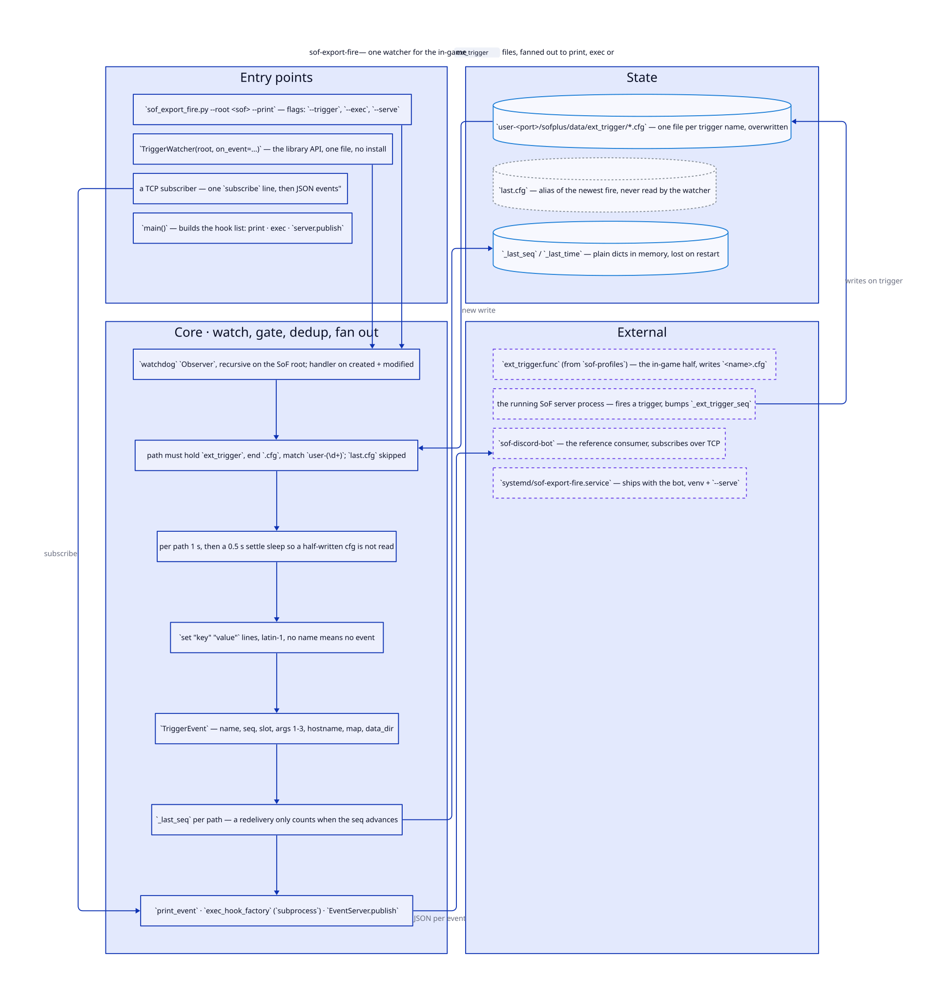

# sof-export-fire — for humans

> A single-file Python watcher that turns the files SoFPlus `ext_trigger` writes in-game into real out-of-game events: printed, executed, or published to TCP subscribers.

Read it left to right:

- **It is a file contract, not an API.** The in-game half (`ext_trigger.func`, canonical copy in `sof-profiles`) fires a named trigger by writing `sofplus/data/ext_trigger/<name>.cfg` with `sp_sc_cvar_save`. Nothing here patches the game: the whole integration is one directory being watched, and the "event" is whatever that file says when it lands.
- **Dedup is about the seq, not the content.** `watchdog` reports a single write several times (created, modified, unrelated mtime bumps), so the watcher does two different jobs: a per-path 1 s cooldown plus a 0.5 s settle sleep to survive the write storm, and a `_last_seq` table to decide whether a real new fire happened. A redelivery only counts when `_ext_trigger_seq` advances, which is also why losing the process state is safe-ish.
- **`last.cfg` is a trap for the naive consumer.** It is an alias of the newest fire, so subscribing to everything would deliver every event twice; it is skipped unless you ask for `--include-last`.
- **The port comes from the path.** One SoF root can hold several server instances (`user-28910`, `user-28911`, …) and the cfg itself never says which server wrote it — `user-(\d+)` is the only identity the watcher has, and it is what consumer code routes on.
- **One watcher, many consumers.** `--serve host:port` publishes every dispatched event as newline-delimited JSON to any TCP client that sent a `subscribe` line (`hello` first, `ping`/`pong` for liveness, unknown lines ignored). `sof-discord-bot` is the reference consumer; `--print` and `--exec` keep working alongside for debugging.

Source: [`docs/system.d2`](docs/system.d2). Edit that, then run [`scripts/render-diagram.sh`](scripts/render-diagram.sh).
